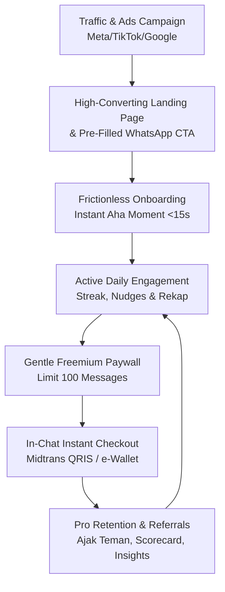

# 🚀 Commercial Transformation & Scale Roadmap
## Chatbot Money Save (HematWoy) — Target: 100K to 1M+ Active Subscribers

> **Dokumen Strategis & Blueprint Produk Komersial**  
> Dibuat: 19 Oktober 2026 | Versi: 1.0  
> Status: Active Implementation Blueprint

---

## 🎯 Visi & Tujuan Produk

Mentransformasikan **HematWoy (Chatbot Money Save)** dari prototipe teknis backend menjadi **produk SaaS B2C FinTech komersial skala industri** yang:
1. Mampu melayani **ratusan ribu hingga jutaan pengguna aktif** secara stabil dan efisien.
2. Memiliki **funnel konversi iklan berbayar (Meta Ads, TikTok Ads, Google Ads)** dengan Return on Ad Spend (ROAS) tinggi dan Cost Per Acquisition (CAC) rendah.
3. Menjalankan model bisnis **Freemium to Paid Subscription** dengan pembayaran instan (QRIS / e-Wallet / Virtual Account via Midtrans).
4. Memiliki **retensi pengguna jangka panjang (high D30/D90 retention)** melalui gamifikasi, kebiasaan harian (*daily habit loop*), dan *zero-friction experience*.

---

## 🔍 Analisis Kritis: Gap Prototipe vs Standar Komersial

| Aspek | Kondisi Prototipe Saat Ini | Standar Produk Komersial (Siap Iklan & Jutaan User) |
| :--- | :--- | :--- |
| **Traffic & Web (`/`)** | Route web langsung melempar ke dashboard/login tanpa konteks. | **High-Converting Landing Page** dengan visual fintech modern, social proof, live demo, pricing, dan tombol CTA langsung ke WhatsApp. |
| **WhatsApp Tone of Voice** | Bahasa teknis/kaku (cth: *"Hubungi endpoint pembelian"*). | Bahasa ramah, humanis, personal (menyebut nama), persuasif, dan visual cards bersih (*clean emojis & typography*). |
| **Onboarding Pengguna** | Kompleks; meminta PIN enkripsi di awal interaksi. | **Instant "Aha! Moment" (< 15 detik)**: User langsung bisa catat pengeluaran pertama tanpa hambatan; PIN/keamanan diperkenalkan secara bertahap. |
| **Paywall & Checkout** | Instruksi manual tanpa link pembayaran langsung di chat. | **1-Click WhatsApp In-Chat Checkout**: Bot langsung mengirimkan link Midtrans Snap (QRIS, GoPay, ShopeePay, VA) dengan aktivasi instan otomatis. |
| **Campaign & Ads Support** | Belum ada tracking traffic iklan atau kode promo. | **UTM Attribution Engine**, Pre-filled WhatsApp Ads link, dan **Voucher/Promo Code System** (cth: `HEMATGAJIAN50`). |
| **User Retention** | Bergantung pada inisiatif pengguna sendiri untuk mencatat. | **Trigger-Action-Reward Loop**: Pengingat cerdas malam hari (20:00 WIB), **Streak Counter** (🔥 7 hari rutin), dan **Weekly Financial Scorecard**. |
| **Web Dashboard** | Tampilan fungsional standar. | **Fintech-Grade UI/UX**: Dark/Light mode, Bento-grid visual analytics, ringkasan per dompet, dan portal manajemen langganan/invoice. |

---

## 🏛️ 5 Pilar Strategis Eksekusi Komersial



---

### PILAR 1: Growth Engine & Ads Funnel (Akuisisi Pengguna)

Traffic iklan berbayar sangat sensitif terhadap *drop-off rate*. Funnel harus dirancang tanpa celah:

1. **High-Converting Landing Page di Web (`/`)**:
   - **Hero Section**: Headline persuasif (*"Bantu Kamu Bebas Boncos Cuma Lewat WhatsApp"*), subheadline yang kuat, visual mock-up smartphone WhatsApp interaktif, dan CTA utama: **"Mulai Gratis di WhatsApp Sekarang"**.
   - **Interactive Simulator**: Pengunjung web bisa mengetik pengeluaran dummy di layar web dan melihat cara bot membalas secara instan.
   - **Feature Bento-Grid**: Visualisasi Multi-Dompet, Pengingat Budget Otomatis, Laporan Excel 1-Klik, dan Enkripsi Privasi.
   - **Pricing Table Transparan**:
     - **Free (Rp0)**: 100 transaksi gratis, 1 dompet kas, rekap dasar harian/bulanan.
     - **Pro Bulanan (Rp25.000/bln)**: Unlimited transaksi, Multi-dompet tanpa batas, Budget alert, Rekap Excel/PDF, Smart Insights.
     - **Pro Tahunan (Rp199.000/thn - Diskon 35%)**: Semua fitur Pro + Prioritas AI financial advisor.
   - **FAQ & Social Proof / Testimonial**: Mengatasi keraguan umum pengguna seputar keamanan data WhatsApp.

2. **Ads Integration & Attribution**:
   - Parameter campaign pada link WhatsApp: `https://wa.me/{BOT_NUMBER}?text=Halo%20HematWoy,%20mau%20coba%20gratis%20[REF=TIKTOK_ADS_01]`.
   - Bot mendeteksi kode referensi iklan untuk analytics dashboard: menghitung ROAS dan konversi per campaign ads.

3. **Promo Code Engine**:
   - Perintah bot: `promo <KODE>` (contoh: `promo GAJIANHEMAT`, `promo RAMADHANPRO`).
   - Diskon harga langganan atau bonus perpanjangan masa aktif otomatis.

4. **Viral Referral System ("Ajak Teman")**:
   - Perintah bot: `ajak teman` / `referral`.
   - Bot memberikan link unik: *"Ajak 1 teman pakai HematWoy, kamu dan temanmu masing-masing dapat tambahan +14 hari Pro Gratis!"*

---

### PILAR 2: Conversational UX & Human Onboarding (WhatsApp Experience)

WhatsApp adalah ruang personal. Pendekatan harus terasa seperti asisten pribadi yang ramah, bukan bot mesin:

1. **Onboarding Tanpa Hambatan (Zero-Friction First Run)**:
   - Pengguna baru mengirim pesan apa pun (misal: *"Halo"* atau *"Beli bakso 25rb"*).
   - Bot langsung merespons ramah:
     > 👋 *Halo Kak [Nama]! Selamat datang di HematWoy 💰*  
     > Asisten pintar pencatat keuangan pribadi langsung di WhatsApp.  
     >  
     > 💡 *Coba ketik sekarang:*  
     > `keluar 25rb makan siang` atau `masuk 500rb freelance`
   - Setup PIN keamanan baru ditawarkan secara halus setelah transaksi ke-3 atau ke-5 saat pengguna sudah merasakan nilai produknya (*value first, security follows*).

2. **Visual Reply Cards Standar Komersial**:
   - Pemformatan pesan konsisten dengan hierarki visual yang jelas:
     ```text
     ✅ *Pengeluaran Dicatat*
     ───────────────────────
     💸 Nominal  : Rp25.000
     🏷️ Kategori : 🍔 Makanan & Minuman
     👛 Dompet   : Cash (Sisa Rp325.000)
     ───────────────────────
     📊 *Budget Makanan:* Rp450.000 / Rp1.000.000
     ████████░░░░░░░░░░░░ 45%
     ```

3. **Interactive Navigation (Interactive Buttons & List Menu)**:
   - Dukungan tombol WhatsApp Business API untuk menu cepat:
     - `[💰 Cek Saldo]` `[📊 Rekap]` `[⭐ Upgrade Pro]`

---

### PILAR 3: Seamless Monetization & In-Chat Checkout

Monetisasi harus semudah memesan kopi online:

1. **In-Chat Snap Checkout (Midtrans API)**:
   - Saat pengguna mengetik `langganan`, `beli pro`, atau kuota gratisnya tinggal sedikit (sisa 10):
     ```text
     ⭐ *HematWoy Pro — Akses Tanpa Batas*
     ───────────────────────────────────
     Kamu sudah mencatat 90 transaksi dengan rapi! 
     Jangan biarkan pencatatan keuanganmu terhenti.

     ✨ *Fitur Spesial Pro:*
     • Unlimited pencatatan transaksi sepuasnya
     • Multi-Dompet (BCA, Mandiri, GoPay, OVO, Cash)
     • Peringatan Anti-Boncos (Budget Alerts)
     • Download Laporan Excel (.xlsx) instan

     💳 *Pilihan Paket:*
     1. Pro 1 Bulan  : Rp25.000
     2. Pro 1 Tahun  : Rp199.000 (Hemat 35%)

     👉 *Klik link berikut untuk bayar via QRIS/GoPay/VA:*
     https://app.hematwoy.com/pay/{token_checkout}
     ```
2. **Instant Webhook Activation**:
   - Begitu pembayaran terverifikasi oleh Midtrans, sistem otomatis mengirim pesan selebrasi ke WhatsApp pengguna:
     ```text
     🎉 *Hore! Akun HematWoy Pro Kamu Sudah Aktif!*
     Masa aktif: s/d 19 November 2026.
     Terima kasih telah berinvestasi untuk masa depan finansialmu! 🚀
     ```

---

### PILAR 4: Retention, Churn Prevention & Gamification

Tantangan nomor 1 aplikasi keuangan adalah: *User berhenti mencatat setelah 3-7 hari*. Fitur retensi adalah kunci LTV (Lifetime Value) tinggi:

1. **Smart Daily Habit Nudges (Jam 20:00 - 21:00 WIB)**:
   - Jika pengguna belum mencatat pengeluaran sama sekali sepanjang hari:
     > *"Selamat malam Kak [Nama]! 🌙 Ada jajan, makan, atau belanjaan yang belum sempat dicatat hari ini? Ketik santai aja di sini ya, misal: `keluar 15rb kopi`."*
   - Notifikasi dapat dihidupkan/dimatikan dengan perintah: `notif on` / `notif off`.

2. **Streak Counter (Gamifikasi Konsistensi)**:
   - *"🔥 Keren! 5 hari berturut-turut kamu konsisten mencatat keuangan!"*
   - Badges capaian: 7 Days Master, 30 Days Budget King.

3. **Weekly Financial Scorecard (Tiap Minggu Malam)**:
   - Infografis teks rapi yang merangkum kesehatan finansial mingguan:
     - Total pengeluaran minggu ini vs minggu lalu (naik/turun %).
     - Kategori terboros minggu ini.
     - Rekomendasi hemat untuk minggu depan.

4. **Proactive Overspending Alerts**:
   - Jika pengeluaran pada suatu kategori mencapai 80% dan 100% dari plafon budget:
     > *"⚠️ Perhatian! Budget Makananmu sudah terpakai 85% (Sisa Rp150.000). Masih ada 12 hari hingga akhir bulan. Yuk lebih hemat!"*

---

### PILAR 5: Fintech-Grade Web Dashboard (Vue 3 SPA)

Web dashboard berfungsi sebagai portal kendali lengkap bagi pengguna aktif:
1. **Landing Page Publik di `/`**: Portofolio produk dan pintu masuk traffic iklan.
2. **Dashboard Aplikasi di `/dashboard`**:
   - Visualisasi grafik arus kas bulanan (Chart.js / ApexCharts).
   - Visualisasi pie chart alokasi pengeluaran per kategori.
   - Manajemen dompet & transfer antar dompet dengan antarmuka seret-lepas (*drag & drop*).
3. **Billing & Subscription Portal**:
   - Melihat sisa masa aktif Pro.
   - Riwayat tagihan dan invoice pembayaran.
   - Perpanjang langganan 1-klik dengan QRIS.

---

## 📅 Roadmap Pelaksanaan Bertahap (Sprint Execution)

### 🔹 Sprint 1: Commercial Polish & In-Chat Checkout (Quick Wins)
- [ ] Ubah seluruh copywriting WhatsApp di `WebhookController.php` menjadi ramah, elegan, dan profesional.
- [ ] Perbaiki alur onboarding pengguna baru (tidak memaksa PIN di awal).
- [ ] Implementasikan flow `langganan` dan `beli pro` yang langsung menghasilkan URL pembayaran Midtrans Snap asli.
- [ ] Implementasikan halaman `/pay/{token}` di web untuk proses checkout QRIS / e-Wallet instan.

### 🔹 Sprint 2: High-Converting Marketing Landing Page
- [ ] Buat komponen Landing Page premium di web (`resources/js/views/LandingPageView.vue` atau blade view di `/`).
- [ ] Pasang Hero section, Fitur Showcase, Pricing Table (Free vs Pro), dan FAQ.
- [ ] Tombol CTA langsung menuju WhatsApp dengan format pre-filled pesan.
- [ ] Optimasi SEO, responsive design smartphone, dan kecepatan muat < 1 detik.

### 🔹 Sprint 3: Ads Tracking & Growth Engine
- [ ] Parser parameter campaign WhatsApp (UTM / Ad Identifier).
- [ ] Fitur voucher & promo code (`promo GAJIAN50`).
- [ ] Fitur referral "Ajak Teman" berhadiah masa aktif Pro.

### 🔹 Sprint 4: Retention, Gamification & Automation
- [ ] Sistem streak harian pengguna.
- [ ] Cron scheduler pengingat malam hari (20:00 WIB) untuk pengguna aktif.
- [ ] Weekly Financial Scorecard otomatis tiap Minggu malam.
- [ ] Peringatan proaktif saat budget kategori mendekati habis.

---

## 📊 Indikator Kinerja Utama (KPIs & Target Metrik)

| Metrik | Target Prototipe | Target Komersial Skala Penuh |
| :--- | :--- | :--- |
| **Onboarding Completion Rate** | < 40% (karena ada setup PIN) | **> 85%** (catat transaksi dalam 30 detik) |
| **Free-to-Paid Conversion** | < 1% | **3% - 6%** dari total pengguna aktif |
| **Day-30 Retention (D30)** | < 15% | **> 40%** (didukung daily habit nudges) |
| **Monthly Churn Rate** | Tidak terukur | **< 7%** |
| **Waktu Respon WhatsApp** | < 1.5 detik | **< 800 ms** (Decoupled Redis Queue) |

---
*Dokumen ini merupakan acuan resmi untuk setiap penulisan fitur, refactoring kode, dan perancangan UI/UX ke depan pada project Chatbot Money Save.*
