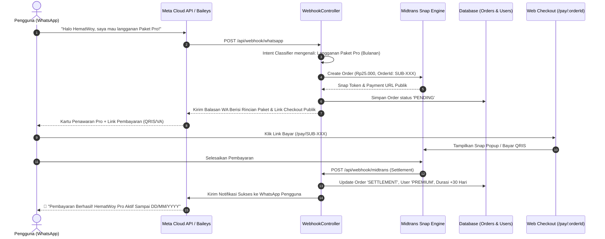
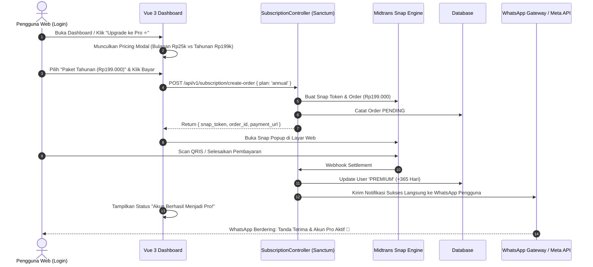
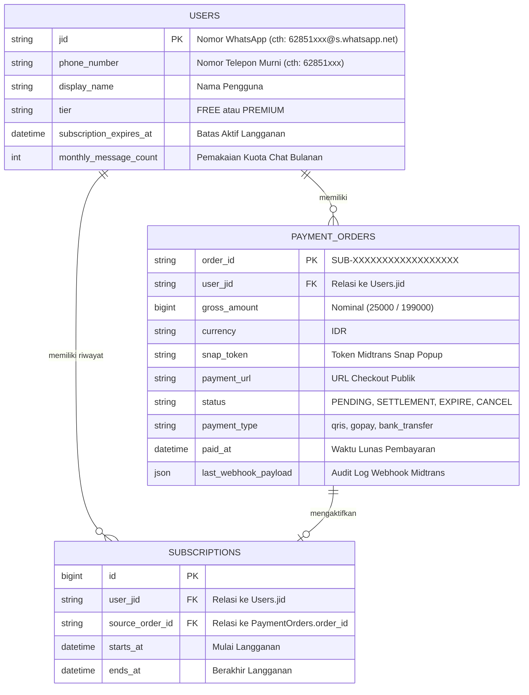

# 💳 Blueprint & Rencana Integrasi Pembayaran End-to-End
## HematWoy (Chatbot Money Save) — Web & WhatsApp Dual-Channel Payment Flow

> **Status Dokumen**: Rencana & Analisis Komprehensif Siap Eksekusi  
> **Terakhir Diperbarui**: 19 Oktober 2026  
> **Dokumen Terkait**: [COMMERCIAL_ROADMAP.md](file:///d:/Project%20Personal/chatbot%20money%20save/COMMERCIAL_ROADMAP.md) | [README.md](file:///d:/Project%20Personal/chatbot%20money%20save/README.md)

---

## 📌 1. Latar Belakang & Analisis Masalah

Berdasarkan pengujian nyata di WhatsApp, pengguna yang mengklik tombol CTA paket dari Landing Page mengirimkan pesan:
```text
"Halo HematWoy, saya mau langganan Paket Pro!"
```
Bot membalas:
```text
🤔 Maaf, saya belum mengenali format pesan:
"Halo HematWoy, saya mau langganan Paket Pro!"

💡 Pilihan Bantuan Cepat:
1 Catat Pengeluaran 👉 keluar 25000 makan siang
...
```

### Temuan Analisis:
1. **Regex Pencocokan Kata Kunci WhatsApp Kaku**:
   - Handler di [`WebhookController.php`](file:///d:/Project%20Personal/chatbot%20money%20save/backend/app/Http/Controllers/Api/WebhookController.php#L349) hanya mencocokkan kata kunci persis 1 atau 2 kata: `/^(?:beli\s+pro|langganan|upgrade(?:\s+pro)?|paket\s+pro|berlangganan|premium)$/i`.
   - Pesan percakapan alami yang diawali salam seperti `"Halo HematWoy, saya mau langganan Paket Pro!"` atau variasi `"mau langganan tahunan"` gagal dicocokkan dan jatuh ke parser transaksi standar yang menghasilkan error.

2. **Deteksi Pilihan Paket Belum Otomatis**:
   - Pengguna memilih paket tertentu (**Paket Pro Bulanan Rp25.000** atau **Paket Tahunan Rp199.000**).
   - Bot belum mengekstrak intent paket yang diinginkan sehingga belum bisa langsung men-generate invoice tagihan dengan nominal yang tepat.

3. **URL Pembayaran di WhatsApp Belum Dinamis Mengikuti Domain Publik**:
   - Link tagihan yang dihasilkan menggunakan `url("/pay/{$order->order_id}")`. Jika `.env` berisi `APP_URL=http://localhost:8000`, maka link yang terkirim ke WhatsApp pengguna di smartphone tidak dapat diakses dari jaringan publik internet/ngrok.

4. **Belum Ada Flow Pembelian Langsung di Web App**:
   - Pengguna yang sudah login di Web Dashboard (`/dashboard`) tidak memiliki tombol atau modal untuk melakukan upgrade paket secara mandiri di web.
   - Endpoint `SubscriptionController::purchase` saat ini terkunci di balik middleware `gateway` (khusus Baileys), sehingga web user berbasis Sanctum tidak bisa memanggilnya.

5. **Relasi Webhook 🔁 WhatsApp Terputus (Belum Ada Outbound Notification)**:
   - Ketika pembayaran Midtrans sukses (atau disimulasikan lunas di web), database berhasil mengupdate user ke `PREMIUM`.
   - Namun, sistem **belum mengirimkan pesan konfirmasi/notifikasi tanda terima resmi ke nomor WhatsApp pengguna**. Akibatnya pengguna merasa transaksi di web tidak ada hubungannya dengan akun WhatsApp-nya.

---

## 🏛️ 2. Diagram Arsitektur & Alur Pembayaran Terintegrasi

### A. Alur Pembelian via WhatsApp (In-Chat Direct Checkout)



---

### B. Alur Pembelian via Web App Dashboard (In-Web Checkout)



---

## 🗄️ 3. Struktur Data & Relasi Entitas (ERD)



---

## 🛠️ 4. Spesifikasi Komponen & Modifikasi Teknis

### A. WhatsApp NLP Intent Recognition ([WebhookController.php](file:///d:/Project%20Personal/chatbot%20money%20save/backend/app/Http/Controllers/Api/WebhookController.php))
Perluas pencocokan regex dan ekstraksi intent percakapan alami:
1. **Pola Percakapan**:
   - Mendukung frasa yang diawali salam:
     `/^(?:halo\s+hematwoy[,.]?\s*)?(?:saya\s+)?(?:mau\s+)?(?:beli|langganan|upgrade|ambil|daftar|paket)\s*(?:hematwoy\s*)?(?:paket\s*)?(pro|tahunan|bulanan|premium)?/i`
   - Frasa singkat: `langganan`, `upgrade pro`, `paket pro`, `paket tahunan`, `beli pro`.
2. **Ekstraksi Paket**:
   - Jika teks mengandung `tahun` / `annual` / `199` ➡️ Paket **Pro Tahunan** (`Rp 199.000` / 365 hari).
   - Jika teks mengandung `bulan` / `pro` / default ➡️ Paket **Pro Bulanan** (`Rp 25.000` / 30 hari).
3. **Penyusunan URL Publik Dinamis**:
   - Jika request masuk via header host ngrok (`X-Forwarded-Host` atau `Request::getHost()`), gunakan base URL tersebut untuk tautan `/pay/{orderId}`, bukan localhost.

---

### B. Outbound Receipt Notification ([MidtransWebhookController.php](file:///d:/Project%20Personal/chatbot%20money%20save/backend/app/Http/Controllers/Api/MidtransWebhookController.php) & [PaymentCheckoutController.php](file:///d:/Project%20Personal/chatbot%20money%20save/backend/app/Http/Controllers/Api/PaymentCheckoutController.php))
Ketika status order berubah menjadi `SETTLEMENT`:
1. Buat helper pengiriman notifikasi WhatsApp otomatis:
   ```text
   🎉 *PEMBAYARAN BERHASIL — HEMATWOY PRO AKTIF!*
   ───────────────────────────
   Terima kasih telah berlangganan *HematWoy Pro*!
   
   📋 *Rincian Transaksi:*
   • No. Order : SUB-XXXXXXXXXXXX
   • Paket     : HematWoy Pro 30 Hari (atau 1 Tahun)
   • Nominal   : Rp25.000
   • Status    : Lunas (Settlement)
   • Aktif s/d : 19 November 2026
   
   ✨ *Seluruh fitur Pro sudah aktif seketika:*
   ✓ Kuota pencatatan tanpa batas
   ✓ Multi-dompet tanpa limit
   ✓ Download Laporan Excel lengkap
   ✓ Peringatan Plafon Anggaran (Anti-Boncos)
   
   Selamat mengelola keuangan dengan rapi dan bebas boncos! 🚀
   ```
2. Kirim melalui:
   - Meta WhatsApp Cloud API (`sendMetaReply`) jika menggunakan nomor Cloud API.
   - Baileys Gateway Sidecar jika menggunakan nomor lokal gateway.

---

### C. Web App Dashboard Upgrade Experience ([AppLayout.vue](file:///d:/Project%20Personal/chatbot%20money%20save/backend/resources/js/components/layout/AppLayout.vue) & New `PricingModal.vue`)
1. **Sidebar / Header Integration**:
   - Tampilkan badge status akun: `FREE (Sisa Kuota: 74/100)` atau `PRO (Aktif)`.
   - Jika akun `FREE`, sediakan tombol berkilau **"Upgrade ke Pro ⭐"**.
2. **Pricing Modal Terintegrasi**:
   - Pilihan interaktif 2 kartu:
     - **Pro Bulanan**: Rp 25.000 / bulan.
     - **Pro Tahunan**: Rp 199.000 / tahun (Diskon 35%).
   - Tombol **"Bayar Sekarang via QRIS / e-Wallet"**:
     - Memanggil API `POST /api/v1/subscription/create-order`.
     - Membuka popup Snap Midtrans langsung di halaman web pengguna.
     - Begitu sukses, modal menampilkan selebrasi konfeti dan status akun otomatis berubah menjadi Pro tanpa perlu refresh.

---

### D. Landing Page CTA Enhancement ([LandingPageView.vue](file:///d:/Project%20Personal/chatbot%20money%20save/backend/resources/js/views/LandingPageView.vue))
1. Tombol pada bagian Pricing ("Daftar Pro Sekarang" & "Pilih Paket Tahunan"):
   - Jika user belum login: Tetap arahkan ke WhatsApp dengan teks template yang kini **pasti dikenali oleh bot**.
   - Tambahkan tombol sekunder: *"Atau Bayar Langsung di Web"*.
   - Jika user sudah login: Langsung arahkan ke `/dashboard?upgrade=pro` atau buka modal checkout langsung.

---

## 📌 5. Checklist Tahapan Eksekusi

- [x] **Tahap 1 (NLP Parser)**: Perbarui regex dan classifier pesan langganan di `WebhookController.php` agar mengenali semua variasi pesan natural.
- [x] **Tahap 2 (Dynamic Order Amount)**: Sambungkan pemilihan paket bulanan (Rp25k) vs tahunan (Rp199k) di `MidtransService.php` dan `WebhookController.php`.
- [x] **Tahap 3 (Outbound WhatsApp Notification)**: Tambahkan pengiriman notifikasi tanda terima otomatis ke WhatsApp pengguna di `MidtransService::processNotification` dan `PaymentCheckoutController::simulate`.
- [x] **Tahap 4 (Web API Endpoint)**: Buat endpoint `POST /api/v1/subscription/create-order` dengan autentikasi Sanctum di `routes/api.php` dan controller terkait.
- [x] **Tahap 5 (Web UI Upgrade)**: Tambahkan modal pemilihan paket dan tombol "Upgrade Pro" di sidebar `AppLayout.vue` dan dashboard.
- [x] **Tahap 6 (Testing & Verifikasi)**: Jalankan unit & feature tests, tes kirim chat WA asli, dan uji coba pembayaran via Midtrans Snap / simulator.
