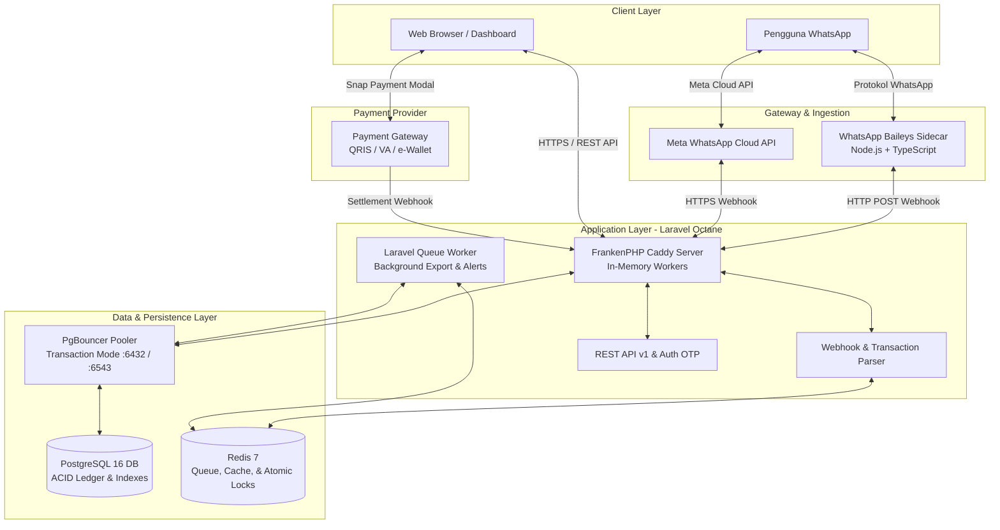

# 💰 HematWoy — Smart Personal Finance Tracker

[](https://laravel.com)
[](https://frankenphp.dev/)
[](https://vuejs.org/)
[](https://www.postgresql.org/)
[](https://redis.io/)
[](https://github.com/WhiskeySockets/Baileys)
[](https://k6.io/)
[-00D1B2?style=for-the-badge&logo=pest)](https://pestphp.com/)

**HematWoy** adalah platform pencatat keuangan pribadi pintar (*all-in-one financial assistant*) yang menggabungkan kemudahan **asisten percakapan WhatsApp** berbasis kecerdasan bahasa alami dengan **Web Dashboard visual modern**. 

Pengguna dapat mencatat pemasukan dan pengeluaran semudah mengirim chat teks biasa, mengelola multi-dompet, menetapkan plafon anggaran (*budgeting*), memantau target tabungan (*goals*), mengekspor laporan Excel (.xlsx) otomatis, hingga melakukan pembayaran langganan Pro secara instan via QRIS dan Virtual Account.

---

## 📑 Daftar Isi

1. [Fitur Unggulan](#-fitur-unggulan)
2. [Arsitektur Sistem](#-arsitektur-sistem)
3. [Struktur Direktori](#-struktur-direktori)
4. [Prasyarat Sistem](#-prasyarat-sistem)
5. [Panduan Instalasi & Setup](#-panduan-instalasi--setup)
6. [Cara Menjalankan](#-cara-menjalankan)
   - [Mode 1: Development Lokal](#mode-1-development-lokal)
   - [Mode 2: Production Skala Besar (Docker FrankenPHP + PgBouncer)](#mode-2-production-skala-besar-docker-compose)
7. [Panduan Perintah WhatsApp Bot](#-panduan-perintah-whatsapp-bot)
8. [Dokumentasi REST API v1](#-dokumentasi-rest-api-v1)
9. [Automated Testing & Load Benchmark (k6)](#-automated-testing--load-benchmark-k6)
10. [Konfigurasi Environment (.env)](#-konfigurasi-environment-env)
11. [Troubleshooting & FAQ](#-troubleshooting--faq)

---

## ✨ Fitur Unggulan

### 🤖 1. Asisten Finansial Percakapan WhatsApp (Conversational Bot)
- **Natural Language Parsing (Bahasa Indonesia Sehari-hari):**
  - Pengeluaran: `keluar 25000 nasi padang`, `beli bensin 50rb via bca`, `-35k kopi susu`.
  - Pemasukan: `masuk 5000000 gaji bulanan`, `terima 250k bonus ke mandiri`, `+1.5jt freelance`.
  - Fleksibilitas format angka: konversi otomatis satuan `k`, `rb`, `ribu`, `jt`, `juta`, pemisah titik dan koma (`25.000`, `1,5jt`).
- **ACID Double-Entry Ledger & Mutasi Saldo Real-Time:**
  - Setiap mutasi mencatat snapshot saldo akhir (`balance_after`) anti-race condition dengan *database transaction lock* & *Redis atomic locks*.
- **Koreksi & Pembatalan Transaksi Cepat:**
  - `koreksi 35rb`: Koreksi nominal transaksi terakhir secara instan tanpa perlu repot mengetik ID.
  - `batal`: Batalkan (*undo*) transaksi terakhir seketika dan saldo otomatis pulih.
  - `ubah transaksi <ID> <Nominal> <Keterangan>` & `hapus transaksi <ID>`.

### 👛 2. Manajemen Multi-Dompet (Multi-Wallets)
- Buat dan pantau banyak dompet: Tunai (`Cash`), Rekening Bank (`BCA`, `Mandiri`, `BRI`), hingga e-Wallet (`GoPay`, `OVO`, `DANA`).
- **Transfer Antar-Dompet:** `transfer 200rb dari Cash ke BCA` (otomatis menggeser saldo tanpa mempengaruhi catatan pemasukan/pengeluaran bersih).

### 🎯 3. Plafon Anggaran (Budgeting) & Target Tabungan (Financial Goals)
- **Smart Budget Limit:** `budget makan 1.5jt` — Bot otomatis memunculkan progress bar persentase sisa kuota budget saat pengeluaran dicatat.
- **Financial Goals:** `buat target Mobil 100jt` dan catat tabungan rutin `tabung 1jt untuk Mobil via bca`.

### ⏰ 4. Transaksi Rutin / Pengingat Langganan (Recurring Schedules)
- `langganan Netflix 186rb setiap tanggal 15 via dana` — Dijadwalkan otomatis masuk pembukuan tanpa lupa.

### 🌐 5. Web App Dashboard & Custom Checkout (Vue 3 + Tailwind CSS)
- **Dashboard Visual:** Grafik arus kas bulanan, pie chart distribusi pengeluaran per kategori, dan metrik kesehatan finansial.
- **Autentikasi OTP WhatsApp:** Login aman tanpa kata sandi rumit, kode verifikasi 6 digit dikirimkan langsung oleh bot ke nomor WhatsApp pengguna.
- **Halaman Checkout Terintegrasi (`/pay/:orderId`):** Pembayaran langganan resmi Pro Bulanan & Tahunan via QRIS, Virtual Account bank, dan e-Wallet dengan status konfirmasi otomatis (*white-labeled*).

### 🛡️ 6. Keamanan & Retensi Data Skala Jutaan Pengguna
- **Zero-Knowledge Encryption (AES-256-GCM):** Nominal transaksi dan saldo akun dienkripsi rapat. Dilengkapi Master PIN pengaman dan Emergency Recovery Code 16-karakter.
- **Idempotensi Pesan & Auto-Pruning:** Tabel `processed_messages` memblokir duplikasi pesan dari WhatsApp. Command `messages:prune --days=30` berjalan otomatis untuk mencegah disk database membengkak.
- **Security Hardening:** Middleware keamanan `X-Content-Type-Options: nosniff`, `Referrer-Policy`, `X-Frame-Options`, dan CSP.

---

## 🏗️ Arsitektur Sistem



---

## 📁 Struktur Direktori

```text
chatbot-money-save/
├── backend/                        # Backend Engine (Laravel 11 + Octane FrankenPHP + Vue 3)
│   ├── app/
│   │   ├── Console/Commands/       # Artisan Commands (messages:prune, finance:simulate)
│   │   ├── Exports/                # Export Excel Multi-Sheet (Maatwebsite Excel)
│   │   ├── Http/Controllers/Api/   # Webhook, Transaction, Wallet, Budget, Goal, Plan, Checkout
│   │   ├── Http/Middleware/        # SecurityHeaders, AuthenticateGateway
│   │   ├── Models/                 # User, Transaction, Wallet, Budget, Goal, Subscription, BotMenu
│   │   └── Services/               # TransactionParser, Finance, Midtrans, Encryption, Insights
│   ├── config/                     # Konfigurasi database, cache, octane, services
│   ├── database/migrations/        # Schema ACID ledger, multi-dompet, dan indeks performa
│   ├── resources/
│   │   ├── css/                    # Tailwind CSS v4 styling
│   │   └── js/                     # Vue 3 Single Page Application (Views, Components, Stores, Router)
│   ├── routes/                     # api.php, web.php, console.php
│   ├── Dockerfile                  # 3-Stage Multi-Build Produksi (Composer + Node + FrankenPHP)
│   ├── docker-entrypoint.sh        # Entrypoint aman multi-replica & auto-cache
│   └── composer.json
│
├── whatsapp-gateway/               # Sidecar Gateway WhatsApp (Baileys Engine)
│   ├── src/
│   │   ├── index.ts                # Socket handler & koneksi pairing WhatsApp
│   │   └── queue.ts                # Outbound rate-limiting queue
│   ├── Dockerfile                  # Container gateway Baileys terisolasi
│   └── package.json
│
├── load-tests/                     # Skenario Uji Beban & Performa Grafana k6
│   ├── api-benchmark.js            # Uji endpoint REST API (Health, Plans, Menus)
│   ├── webhook-benchmark.js        # Simulasi lonjakan ribuan chat WhatsApp masuk
│   └── quick-test.js               # Pengujian latensi cepat
│
├── k8s/                            # Manifest Produksi Skala Raksasa (Kubernetes)
│   ├── hpa.yaml                    # Horizontal Pod Autoscaler (Auto-scale hingga 100 worker)
│   ├── deployment-ingress-api.yaml # Pod API Webhook Octane
│   ├── deployment-worker.yaml      # Pod Queue Worker
│   └── service.yaml                # Cloud Load Balancer
│
├── docker-compose.yml              # Orkestrasi Full-Stack (Backend, Gateway, Postgres, Redis, PgBouncer)
├── docker-compose.prod.yml         # Konfigurasi resource limit produksi
└── README.md                       # Dokumentasi Resmi Proyek
```

---

## ⚙️ Prasyarat Sistem

| Komponen | Kebutuhan Minimum | Rekomendasi Produksi |
| :--- | :--- | :--- |
| **PHP** | `^8.2` atau `8.3 / 8.4` | `PHP 8.3` (Ekstensi: `pdo_pgsql`, `redis`, `opcache`, `bcmath`, `pcntl`) |
| **Runtime Server** | `php artisan serve` (Dev) | **FrankenPHP Octane Worker Mode** |
| **Database** | SQLite (Uji Coba Lokal) | **PostgreSQL 16 + PgBouncer (Transaction Pooling)** |
| **Cache & Queue** | File / Database driver | **Redis 7 (AOF Enabled)** |
| **Node.js** | `v20.x+` atau `v22.x+` | `Node.js 22 Alpine` & `Yarn` |
| **Container Engine** | Docker Desktop | **Docker Engine 26+ & Docker Compose v2** |

---

## 🚀 Panduan Instalasi & Setup

### 1. Clone Repositori
```bash
git clone https://github.com/TeguhA10/chatbot-money-save.git
cd chatbot-money-save
```

### 2. Setup Backend Laravel & Frontend
```bash
cd backend
cp .env.example .env

# Pasang dependensi PHP & Node.js
composer install
yarn install

# Generate application security key
php artisan key:generate

# Konfigurasikan koneksi database di .env (PostgreSQL atau SQLite)
php artisan migrate --seed

# Kompilasi frontend asset untuk produksi
yarn build
```

### 3. Setup WhatsApp Gateway (Baileys Sidecar)
```bash
cd ../whatsapp-gateway
cp .env.example .env
npm install
npm run build
```

---

## ▶️ Cara Menjalankan

### Mode 1: Development Lokal

Buka 3 tab terminal:

* **Terminal 1 (Backend Server):**
  ```bash
  cd backend
  php artisan serve --port 8000
  ```
* **Terminal 2 (Frontend Dev HMR - Opsional):**
  ```bash
  cd backend
  yarn dev
  ```
* **Terminal 3 (WhatsApp Gateway):**
  ```bash
  cd whatsapp-gateway
  npm run dev
  ```
  *Terminal akan menampilkan **Kode Pairing 8-Karakter**. Buka WhatsApp di smartphone Anda $\rightarrow$ **Perangkat Tertaut** $\rightarrow$ **Tautkan dengan nomor telepon** $\rightarrow$ Masukkan kode tersebut.*

---

### Mode 2: Production Skala Besar (Docker Compose)

Untuk menjalankan seluruh stack (FrankenPHP Octane + Queue Worker + PostgreSQL + PgBouncer Pooler + Redis + WhatsApp Gateway) dalam container terisolasi:

```bash
# Jalankan seluruh stack dengan alokasi resource produksi
docker compose -f docker-compose.yml -f docker-compose.prod.yml up -d --build

# Pantau log server
docker compose logs -f backend
```

---

## 📖 Panduan Perintah WhatsApp Bot

Kirimkan pesan berikut langsung ke nomor WhatsApp bot:

### 1. 💸 Catat Pengeluaran & Pemasukan
| Jenis | Contoh Pesan | Keterangan |
| :--- | :--- | :--- |
| **Pengeluaran** | `keluar 25000 nasi padang`<br>`beli bensin 50rb via bca`<br>`bayar listrik 150.000`<br>`-35k parkir mall` | Mengurangi saldo dompet & mencocokkan kategori otomatis |
| **Pemasukan** | `masuk 5000000 gaji bulanan`<br>`terima 250k bonus ke mandiri`<br>`+1.5jt freelance website` | Menambah saldo dompet tertuju |
| **Koreksi Instan** | `koreksi 30rb` | Mengubah nominal transaksi terakhir secara langsung |
| **Batal (Undo)** | `batal` | Membatalkan transaksi terakhir & saldo otomatis kembali |

### 2. 👛 Dompet & Saldo
| Perintah | Contoh | Keterangan |
| :--- | :--- | :--- |
| `saldo` | `saldo` | Menampilkan total saldo dan rincian per dompet aktif |
| `tambah dompet <nama> [saldo <nominal>]` | `tambah dompet BCA saldo 1jt` | Membuat dompet baru dengan saldo awal |
| `transfer <nominal> dari <asal> ke <tujuan>` | `transfer 200rb dari Cash ke BCA` | Mutasi saldo antar-dompet tanpa mengubah income/expense |

### 3. 🎯 Plafon Anggaran (Budgets) & Target Tabungan (Goals)
| Perintah | Contoh | Keterangan |
| :--- | :--- | :--- |
| `budget <kategori> <nominal>` | `budget makan 1.5jt` | Menetapkan batas maksimal pengeluaran per kategori per bulan |
| `cek budget` | `cek budget` | Menampilkan progress bar pemakaian seluruh kategori anggaran |
| `buat target <nama> <nominal>` | `buat target Liburan 5jt` | Membuat target capaian tabungan baru |
| `tabung <nominal> untuk <nama> [via <dompet>]` | `tabung 500rb untuk Liburan via bca` | Menyisihkan dana tabungan ke target tertentu |
| `daftar target` | `daftar target` | Memeriksa persentase pencapaian seluruh target tabungan |

### 4. ⏰ Langganan Rutin & Laporan Keuangan
| Perintah | Contoh | Keterangan |
| :--- | :--- | :--- |
| `langganan <nama> <nominal> setiap tanggal <tgl>` | `langganan Spotify 55rb setiap tanggal 10` | Mencatat transaksi otomatis bulanan |
| `rekap hari ini` / `rekap bulan ini` | `rekap bulan ini` | Ringkasan visual pemasukan, pengeluaran, dan persentase |
| `export excel` | `export excel` | Bot mengompilasi dan mengirimkan dokumen `.xlsx` multi-sheet |
| `web` | `web` | Mengirimkan tautan langsung ke Web App Dashboard |
| `menu` / `bantuan` | `menu` | Menampilkan daftar panduan perintah terorganisir |

---

## 🔌 Dokumentasi REST API v1

Seluruh endpoint publik berawalan prefix `/api/v1`. Endpoint terautentikasi membutuhkan header `Authorization: Bearer <sanctum_token>`.

### Authentication (WhatsApp OTP)
* `POST /api/v1/auth/request-otp` — Mengirim kode OTP 6 digit ke nomor WhatsApp pengguna.
* `POST /api/v1/auth/verify-otp` — Verifikasi OTP dan mendapatkan personal access token Sanctum.

### Data Keuangan & Analisis
* `GET /api/v1/profile` — Mendapatkan profil pengguna, tier langganan, dan saldo konsolidasi.
* `GET /api/v1/transactions` — Mengambil riwayat transaksi (mendukung filter tanggal, tipe, kategori, dompet).
* `POST /api/v1/transactions` — Menambahkan catatan transaksi via API.
* `GET /api/v1/wallets` & `POST /api/v1/wallets` — Mengelola dompet dan saldo.
* `POST /api/v1/wallets/transfer` — Eksekusi transfer saldo antar-dompet.
* `GET /api/v1/budgets` & `POST /api/v1/budgets` — Mengatur limit plafon pengeluaran.
* `GET /api/v1/goals` & `POST /api/v1/goals` — Mengelola target tabungan.
* `GET /api/v1/analytics/summary` — Ringkasan metrik kesehatan arus kas bulanan.
* `GET /api/v1/export/excel` — Mengunduh file spreadsheet `.xlsx`.

### Monetisasi & Checkout Pembayaran
* `GET /api/v1/plans` — Daftar paket langganan aktif (Bulanan & Tahunan).
* `GET /api/v1/payment/checkout/{order_id}` — Verifikasi status pembayaran order secara real-time.
* `POST /api/webhook/midtrans` — Webhook otomatis verifikasi signature SHA512 aktivasi paket Pro.

---

## 🧪 Automated Testing & Load Benchmark (k6)

### 1. Automated Feature & Unit Tests (Pest PHP)
Sistem memiliki cakupan **144 Automated Tests (100% Lulus)**:

```bash
cd backend

# Menjalankan seluruh 144 automated tests
php artisan test

# Menjalankan pengujian spesifik webhook
php artisan test --filter=WebhookTest
```

### 2. Stress & Performance Testing (Grafana k6)
Pengujian beban performa concurrency tinggi telah disiapkan di folder `load-tests/`:

```bash
# Menjalankan uji performa endpoint REST API publik (Health, Plans, Menus):
k6 run load-tests/api-benchmark.js

# Menjalankan simulasi banjir ratusan chat transaksi WhatsApp:
k6 run load-tests/webhook-benchmark.js

# Menjalankan uji ke alamat remote/domain produksi:
k6 run -e BASE_URL=https://domain-anda.com load-tests/api-benchmark.js
```

---

## ⚙️ Konfigurasi Environment (.env)

| Variabel | Penjelasan | Contoh Nilai |
| :--- | :--- | :--- |
| `APP_ENV` | Mode lingkungan aplikasi | `production` / `local` |
| `OCTANE_SERVER` | Engine high-performance server | `frankenphp` |
| `DB_CONNECTION` | Driver database | `pgsql` / `sqlite` |
| `DB_HOST` | Host database (disarankan pooler) | `pgbouncer` atau host Supabase Pooler |
| `DB_PORT` | Port database | `6432` (PgBouncer) / `6543` / `5432` |
| `CACHE_STORE` | Driver cache sistem | `redis` |
| `QUEUE_CONNECTION` | Antrean proses background | `redis` |
| `GATEWAY_WEBHOOK_SECRET`| Token keamanan gateway sidecar | `string_acak_rahasia_32_karakter` |
| `MIDTRANS_SERVER_KEY` | Server Key resmi Midtrans | `Mid-server-xxxxxxxxxxxx` |
| `MIDTRANS_IS_PRODUCTION`| Status environment pembayaran | `true` / `false` |
| `WHATSAPP_PHONE_NUMBER_ID` | ID nomor Meta Cloud API (jika pakai Cloud API) | `1329679493558003` |

---

## 💡 Troubleshooting & FAQ

### 1. Mengapa pesan `set pin` muncul saat transaksi pertama?
HematWoy menerapkan arsitektur **Zero-Knowledge Encryption (AES-256-GCM)** untuk melindungi privasi data finansial Anda dari kebocoran server. Sebelum transaksi pertama tercatat, pengguna cukup mengetik `set pin 123456` (minimal 6 karakter, bebas angka atau huruf). Bot akan memberikan **Recovery Code 16-karakter** yang wajib disimpan sebagai kunci darurat.

### 2. Bagaimana cara kerja Transaction Pooler (PgBouncer)?
Dalam arsitektur produksi jutaan pengguna, koneksi database PostgreSQL tidak ditahan oleh satu client. PgBouncer di port `6432` bertindak sebagai gerbang: ribuan request konkuren dilayani bergantian secara cepat (*transaction-level pooling*), menjaga penggunaan RAM server tetap rendah dan mencegah error *"Too many connections"*.

### 3. Mengapa tampilan web sempat blank putih saat dibuka lewat ngrok?
Browser modern menerapkan aturan keamanan **Private Network Access (PNA)** yang melarang website HTTPS publik memuat aset dev server lokal `http://[::1]:5173`. Sistem ini telah dilengkapi proteksi otomatis di `AppServiceProvider`: ketika diakses via ngrok/domain publik, framework otomatis menyajikan aset build resmi dari domain yang sama tanpa memicu blokir CORS.

---

## 📄 Lisensi

Proyek ini dilisensikan di bawah lisensi resmi [MIT License](LICENSE).
Hak Cipta © 2026 **HematWoy Team**. Seluruh hak cipta dilindungi undang-undang.
