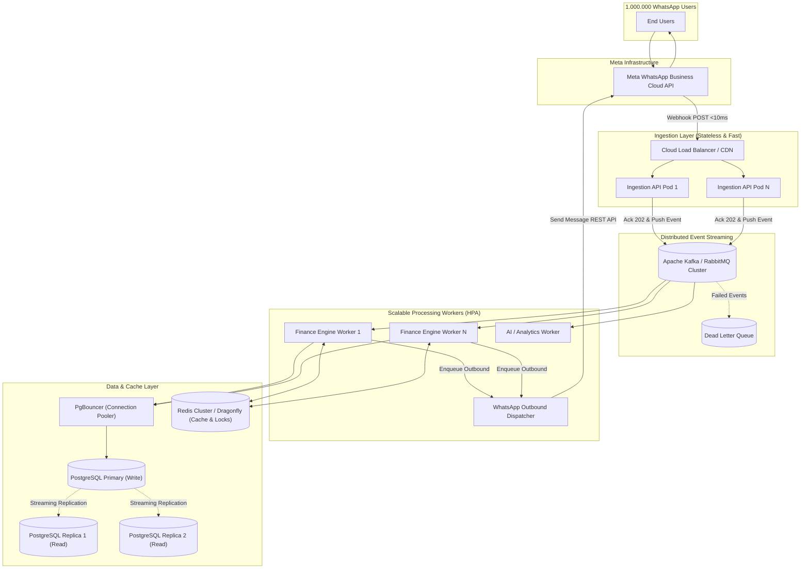

# 🚀 Scalability Roadmap: Menuju 1 Juta Concurrent Users

Dokumen ini berisi peta jalan teknis, analisis kesenjangan (*gap analysis*), dan arsitektur target untuk meningkatkan performa **WhatsApp Personal Finance Bot** dari skala **MVP / Prototype** menuju kesiapan menangani lonjakan **1.000.000 pengguna bersamaan (*concurrent users*)**.

---

## 📌 Ringkasan Status Saat Ini vs Target

| Komponen | Status Saat Ini (MVP) | Target (1 Juta Concurrent Users) |
| :--- | :--- | :--- |
| **WhatsApp Ingestion** | Baileys (WhatsApp Web personal via WebSocket) | **Meta WhatsApp Business Cloud API** (Tier Unlimited) |
| **Database** | SQLite (`storage/database.sqlite`) | **PostgreSQL / Aurora Cluster** + Read Replicas + PgBouncer |
| **Pemrosesan Webhook** | Sinkron (*Synchronous HTTP request-reply*) | **Asinkron & Event-Driven** (Kafka / RabbitMQ / SQS) |
| **Web / Application Server** | Standard PHP-FPM / Built-in Artisan Server | **Laravel Octane** (FrankenPHP / Swoole in-memory workers) |
| **Antrean & Cache** | Redis Single Instance + In-memory Node Queue | **Redis Cluster / Dragonfly** + Distributed Dead-letter Queues |
| **Infrastruktur & Skalabilitas** | Single Node Docker Compose (1 server) | **Kubernetes (K8s) Cluster** + Horizontal Pod Autoscaler (HPA) |
| **Observabilitas** | Pino logger lokal & Laravel `storage/logs` | **Prometheus + Grafana + OpenTelemetry + Nightwatch APM** |

---

## 🏗️ Target Arsitektur Skala Besar (Enterprise Scale)



---

## 🗺️ Tahapan Implementasi (Phased Milestones)

### Fase 1: Migrasi Database ke Skala Enterprise
> **Tujuan:** Menghilangkan batasan fatal *single-writer lock* SQLite (`SQLSTATE[HY000]: database is locked`).

1. **Migrasi Engine ke PostgreSQL / MySQL 8.0+**
   - Buat skrip migrasi data dari SQLite ke PostgreSQL.
   - Perbarui konfigurasi koneksi di `docker-compose.yml` dan `backend/.env`.
2. **Connection Pooling dengan PgBouncer**
   - Pasang PgBouncer di depan database untuk mengelola puluhan ribu koneksi tanpa kehabisan batas memori database (*connection starvation*).
3. **Partitioning & Sharding Tabel Transaksi**
   - Partisi tabel `transactions` berdasarkan rentang waktu (bulanan) atau hash `user_id`.
   - Pisahkan traffic baca (*Read Replicas*) untuk query rekap bulanan/harian agar tidak membebani operasi penulisan transaksi utama.

---

### Fase 2: Transisi ke Meta Official WhatsApp Cloud API
> **Tujuan:** Menghilangkan risiko akun diblokir Meta dan keterbatasan WebSocket Baileys.

*Catatan: Variabel dasar Meta WhatsApp sudah disiapkan di `backend/.env.example` (`WHATSAPP_PHONE_NUMBER_ID`, `WHATSAPP_ACCESS_TOKEN`, dll).*

1. **Aktivasi Akun WhatsApp Business Platform**
   - Verifikasi bisnis di Meta Business Manager.
   - Daftarkan nomor resmi dan tingkatkan limit *Messaging Tier* dari Tier 1 (1.000 kontak/24 jam) ke Tier 4 / Unlimited.
2. **Implementasi Official Webhook Controller**
   - Bangun endpoint verifikasi token Meta (`GET /api/webhook/whatsapp` untuk challenge handshake).
   - Bangun verifikasi signature pesan masuk (`X-Hub-Signature-256`) menggunakan `META_APP_SECRET`.
3. **Outbound Dispatcher via Graph API**
   - Gantikan Baileys socket send dengan HTTP Client asinkron ke `https://graph.facebook.com/v20.0/{phone_number_id}/messages`.

---

### Fase 3: Arsitektur Asinkron & Event-Driven (Decoupled Webhook)
> **Tujuan:** Memastikan endpoint webhook merespons dalam <10ms untuk mencegah timeout saat jutaan request masuk bersamaan.

1. **Stateless Webhook Ingestion**
   - Ubah `WebhookController` agar **tidak langsung mengeksekusi logika keuangan di thread HTTP**.
   - Alur baru:
     ```
     Pesan Masuk -> Validasi Signature -> Push ke Queue -> Return HTTP 202 Accepted (<10ms)
     ```
2. **Message Streaming Broker**
   - Gunakan **Apache Kafka**, **RabbitMQ**, atau **Redis Streams** untuk menampung lonjakan jutaan pesan tanpa membebani backend.
3. **Worker Pool Auto-Scaling**
   - Worker pool memproses pesan dari antrean, mengeksekusi ledger keuangan, dan memasukkan balasan ke antrean pengiriman.

---

### Fase 4: Upgrade Engine & Distributed Caching
> **Tujuan:** Memaksimalkan throughput per server dan meminimalkan latensi CPU/Memory.

1. **Adopsi Laravel Octane (FrankenPHP / Swoole)**
   - Menghilangkan proses boot Laravel berulang kali di setiap request.
   - Peningkatan performa hingga 5x–10x RPS dibandingkan PHP-FPM standar.
2. **Distributed Cache & Atomic Locks (Redis Cluster)**
   - Gunakan Redis Atomic Lock (`Cache::lock("user:{$id}", 5)`) untuk memastikan konsistensi mutasi saldo per user tanpa race condition.
   - Cache user profile, kategori, dan status langganan di Redis dengan TTL terukur.

---

### Fase 5: Infrastruktur Cloud & Kubernetes (K8s)
> **Tujuan:** Skalabilitas horizontal elastis dan ketersediaan tinggi (*High Availability 99.99%*).

1. **Container Orchestration (Kubernetes)**
   - Pisahkan pod menjadi:
     - `ingress-api`: Khusus melayani webhook masuk dari Meta.
     - `core-workers`: Khusus memproses transaksi keuangan.
     - `outbound-workers`: Khusus mengirim pesan balasan ke Meta.
2. **Horizontal Pod Autoscaler (HPA)**
   - Skalakan pod secara dinamis berdasarkan metrik CPU, memory, dan *queue lag* (kedalaman antrean pesan).
3. **Observabilitas & APM**
   - Integrasikan **Laravel Nightwatch / OpenTelemetry** untuk memantau performa query dan bottleneck.
   - Setup alert real-time via Prometheus + Grafana untuk metrik: error rate, queue lag, dan database IOPS.

---

## 📋 Checklist Prioritas & Status Implementasi

- [x] **Prioritas 1 (Kritis)**: Ganti SQLite dengan PostgreSQL di lingkungan produksi (`docker-compose.yml` & `docker-compose.prod.yml`).
- [x] **Prioritas 1 (Kritis)**: Integrasi Meta WhatsApp Cloud API resmi (Webhook verification, `X-Hub-Signature-256`, dan Outbound Graph API di `WebhookController`).
- [x] **Prioritas 2 (Tinggi)**: Ubah endpoint webhook menjadi *asynchronous ingestion* (Job `ProcessIncomingWhatsAppMessage` di-dispatch ke Redis Queue dengan return HTTP 202 <10ms).
- [x] **Prioritas 2 (Tinggi)**: Pasang atomic lock berbasis Redis (`Cache::lock("user_balance:{$jid}", 10)`) di transaksi keuangan (`recordTransaction`, `transferFunds`, `undoLastTransaction`).
- [x] **Prioritas 3 (Menengah)**: Implementasi Laravel Octane dengan FrankenPHP di `backend/Dockerfile`.
- [x] **Prioritas 3 (Menengah)**: Setup Connection Pooling PgBouncer di `docker-compose.yml`.
- [x] **Prioritas 4 (Jangka Panjang)**: Deployment manifest Kubernetes (`k8s/` berisi Ingress API, Scalable Workers, Service, ConfigMap, Secrets, dan HPA).
